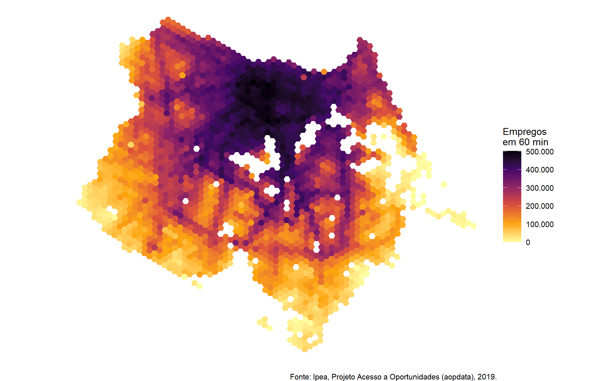
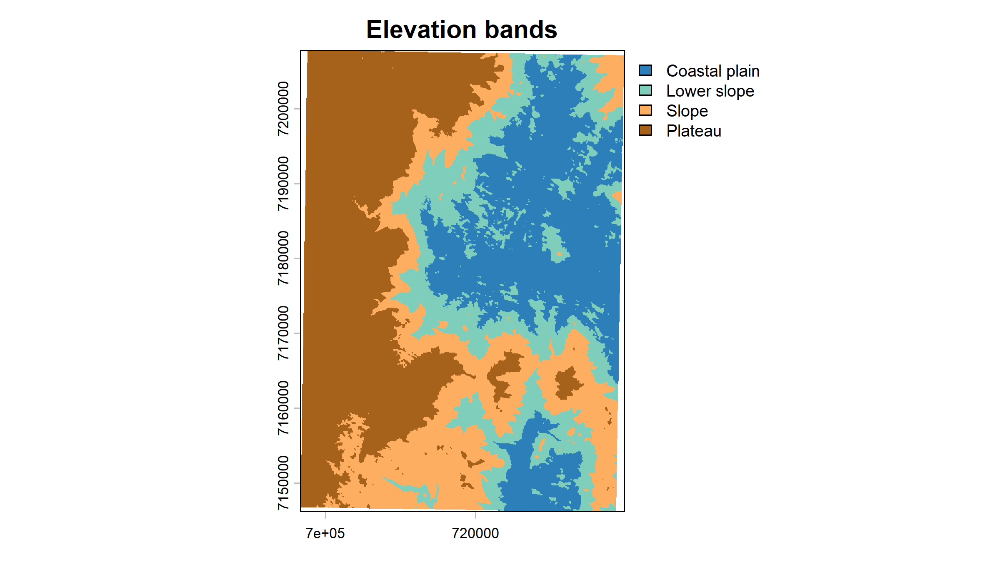
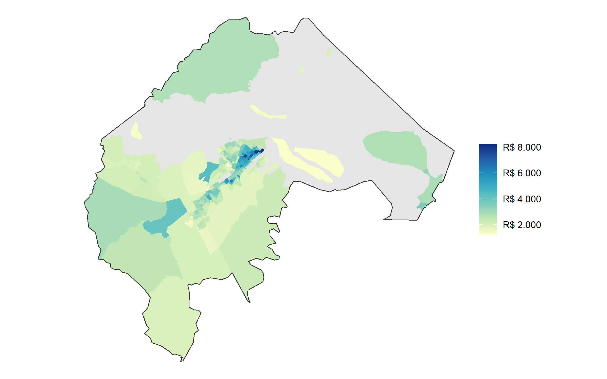
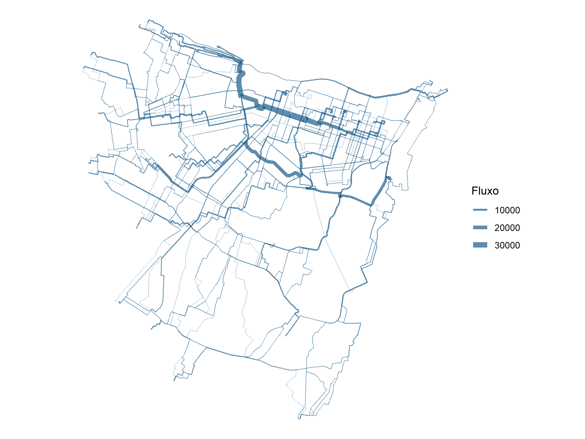

If I had to choose a course to teach, it would definitely be one about transport and R. As it turns out, that was exactly what the Brazilian Ministry of Transportation was looking for. In this 30-hour course, I put together everything I've learned about R, transportation, and Brazilian public datasets, with applications and case studies.

We went from the fundamentals to spatial analysis, routing, geocoding, accessibility analysis, and reproducible reports with Quarto.

Everything runs locally with open-source tools and a range of state-of-the-art packages, such as `sf`, `duckspatial`, `dodgr`, `duckdb`, `r5r`, and `gtfstools`, along with Brazilian packages (`geobr`, `geocodebr`, `aopdata`, `accessibility`). Many of them were built by my colleagues at Ipea (Rafael Pereira, Daniel Herszenhut, Pedro Andrade, Kauê Braga, Marcos Saraiva, and many others).

The course website, with all the code and data, is free and public: <https://joaobazzo.github.io/curso-r-transportes/>

A special thank you to the staff of the Ministry of Transportation, especially Thiago Cunha, Aline Contar, and Helena Santos.

  
  
  
  

